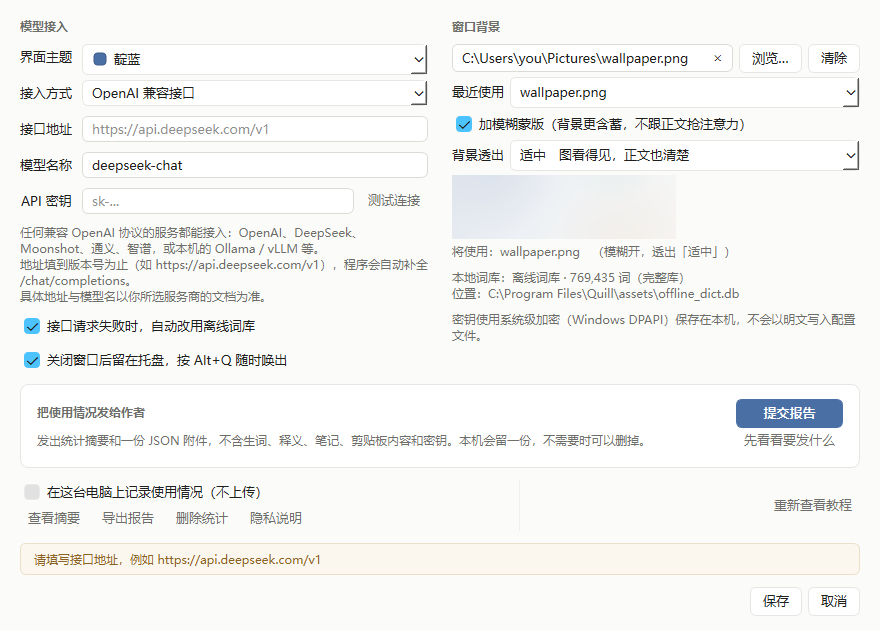
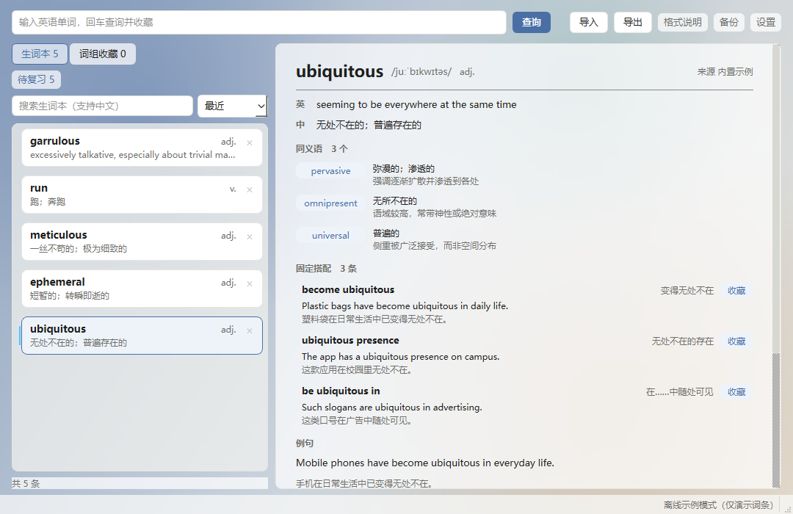
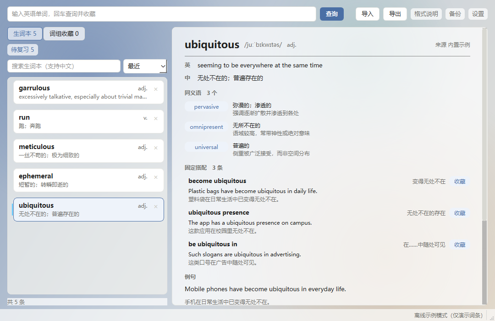
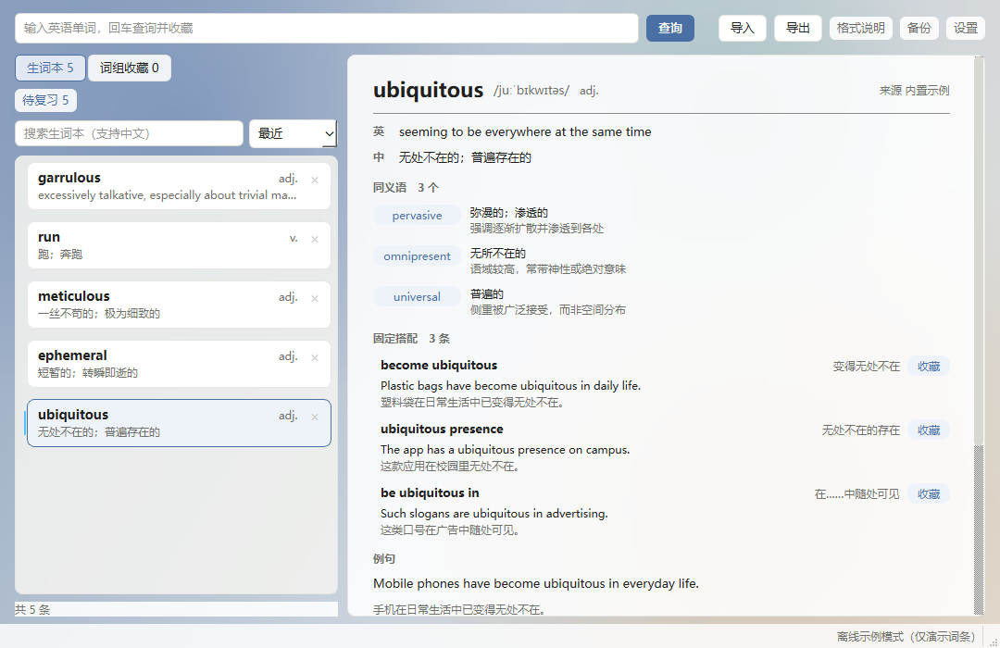
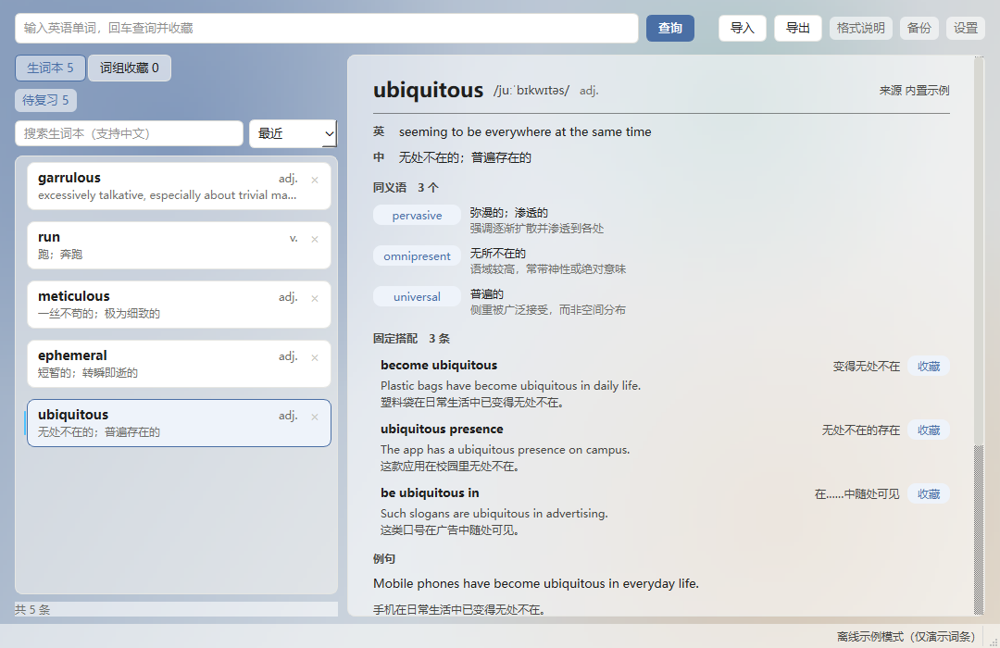
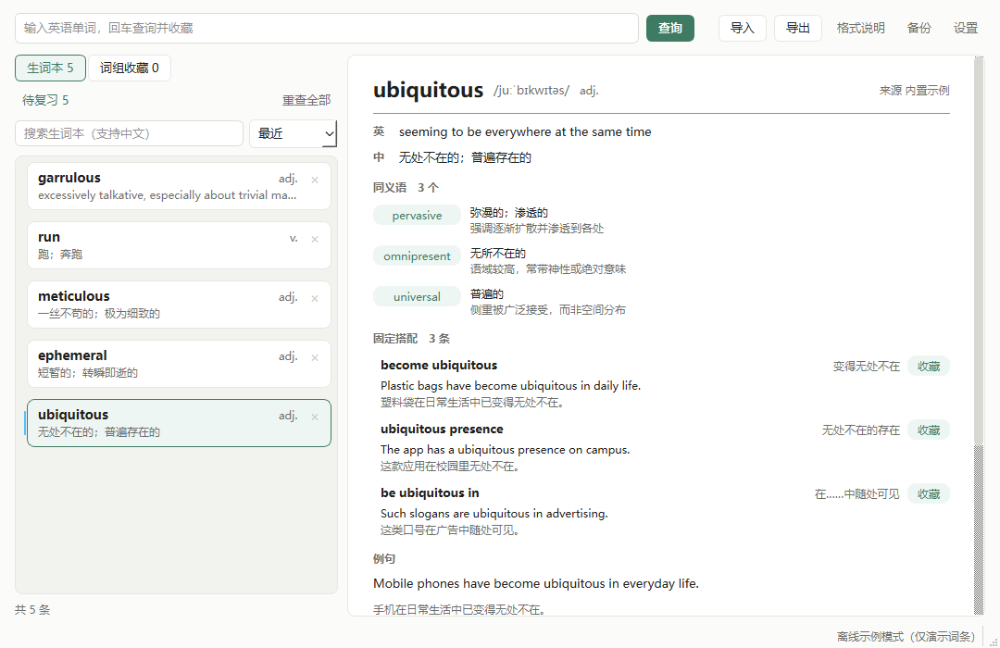
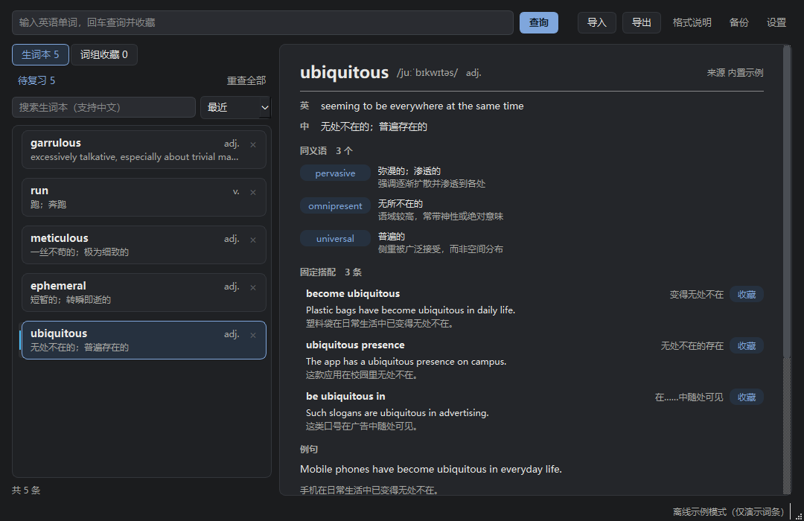

# Quill · 英语生词本

一个装在 Windows 上的生词本。敲一个词回车就存下，释义、例句、搭配跟着进来，不用再抄第二遍。断网也能查，包里带着一本 76.9 万词的离线词典。

生词都在自己电脑上的一个 `.db` 文件里，拷走就带走。换台机器不会什么都不剩。

v1.3.0（2026-10-28）：新增本地使用统计（默认关闭、可随时删）、从备份恢复、复习第四档与学习摘要。[下载免安装版](https://github.com/whitede22/Quill/releases/latest) · [更新记录](https://github.com/whitede22/Quill/blob/main/CHANGELOG.md)

## 界面预览

左栏是生词卡片，每张右上角有个删除按钮。右栏放详情，最上面是英文释义，中文释义紧接其后，再往下是同义语的差别、语境例句和固定搭配。


首次启动会有一页欢迎页，点「先看看教程」是四步上手。


接口少给字段时，详情区顶部会写出缺了什么，而不是让空字段悄悄消失。


设置框在保存前就地校验，填错了不会把对话框关掉。



接口失败改用离线词典时，顶部会说明这件事，顺带给出失败原因。


导入生词表会先把识别结果摆出来（认出多少个、按哪种格式认的、跳过了哪些行），核对过再写库。


窗口可以铺一张自己的背景图，模糊蒙版可开关，「背景透出」分含蓄 / 适中 / 明显三档。









六套主题，设置里选一个就整体换色，点「取消」原样还原。深色那套的最坏情况和浅色正好相反：浅色怕背景图那块纯黑，深色怕纯白。





## 它能做什么

- 敲词回车，查完就存下，不用再点一次收藏。
- 读文章攒的生词可以整段粘进来，空格、逗号、分号、换行都算分隔，收完右侧直接跳到第一条。要是早收过 `look forward to` 这种词组，整串就按词组查，不会拆成三个碎片。
- 包里带一本 769,435 词的英汉词典（ECDICT 全量构建，64.8 MB），没配接口时自动用它，断网也能查。
- 窗口收进托盘后按 `Alt+Q` 随时唤出。输入框里已经填好剪贴板里的那个词，回车即查。剪贴板是整句话时不填，只把窗口放到前台。不想让它在后台常驻，设置里关掉「托盘常驻」即可，关掉之后关闭窗口就真的退出。
- 接口挂了会自己换离线词典，详情区顶部写「接口请求失败，以下内容来自本机离线词库」，失败原因也一并写在上面，来源标签写「离线待重查」。这个标签的意思是：这条内容出自本机词库，接上接口重查一次会明显更全，例句、固定搭配、近义辨析只有接口才给。不想这样可以在设置里关掉。
- 之前靠离线词库攒下的词条，接上接口后可以一键重查。左栏「重查全部」按当前列表来，有搜索或标签筛选就只查筛出来的那批。默认跳过已经是接口内容的，想全量刷一遍也能选。接口这次没答上来的词条保持原样，不会被离线内容顶回去。
- 中文也能搜。搜「无处不在」能命中 *ubiquitous*，词形、释义、例句、备注、标签都在范围里，自己写的备注也搜得到。
- 查词时右侧给 3 到 5 条常用搭配，每条配一句例句和中文翻译。有用的可以单独收进词组收藏，它和生词本是并列的两个列表。收过的词组，下次查到含这个词的词条会被列出来。
- 左栏的「待复习 N」是到期条数。点开是一轮会话：先看词回想，翻面看义，再评「忘了 / 模糊 / 记住了 / 太简单」四档。间隔走 SM-2（Anki 那套思路），第一次 1 天、第二次 6 天，之后按熟练度乘系数，选「太简单」跳得更快，答「忘了」退回 1 天。一轮结束给一段摘要：待复习与今日已复习各多少条，已掌握几个、累计复习几次，样本不够就直说不够。复习进度只在本机库里，不进 JSON 导出。
- 导出七种：纯文本、单词表、Markdown、PDF、CSV、Anki 卡片、JSON。JSON 带格式标识和版本号，能被本程序读回来。除单词表外都带搭配；CSV 带 BOM，用 Excel 打开不乱码。
- 单词表是给「重新导入」用的种子：只有单词和中文释义两列，没有标题也没有表尾，一行一条。换机器、重装、或者想用新版接口把旧词重查一遍时，拿它整份导回去就行。音标、例句、搭配、备注都不带，要完整备份请用 JSON。
- 导入认纯文本、Markdown、JSON、有道的单词本 XML，还有 Word 的 .docx。普通词表每行取第一个英文词，行首编号、音标、括号、中文都会跳过；本程序导出过的文件能原样读回。写库之前先把识别结果摆出来给你核对。
- 标签在详情区打，左栏按标签收窄。标签和搜索框是「与」的关系，两个一起生效。筛选按解析出的标签匹配，所以筛「考研」不会把「考研英语」带出来。
- 删错了点状态栏的「撤销删除」，整条回来，备注、标签、收录变体一起回。只留最近一条，反正要救的都是刚手滑那一下。
- 图片可以直接拖进窗口，或在设置里挑一张铺在窗口后面。模糊默认开，照片直铺太吵；背景透出默认适中。三档的可读性代价差得挺多，实测面板区域里次要标签对比度低于 1.5:1 的面积占比是 1.2% / 1.5% / 65.9%，正文在任何档位都守在 4.5:1 以上。
- 重复启动不会开出第二个窗口：新进程把已有窗口叫到前台，自己退出，两个进程同时写库的事不会发生。
- API 密钥走 Windows DPAPI 加密落盘，不存明文。备注和标签自动落盘，重新查询只更新接口给的内容，不碰你写的东西。
- 设置里有一项「在这台电脑上记录使用情况」，默认关，第一次启动会先问一句，关掉那页窗口不算表态。开着时记的是功能使用：查了几次词、每次多久、加了几个词、复习与导入导出各几次、出错时的编号。生词、释义、笔记、例句、剪贴板内容和密钥都不记，数据只在本机，不会自动上传。想看看记了什么可以看摘要；想给作者发一份，生成报告后程序会打开 GitHub 提交页，发不发由你自己决定。
- 设置里有「从备份恢复」。选中的文件先过三道检查：文件在不在、完整性检查过不过、里面有没有词条表，任一项不过就停下，现在的词库不动。都过了才替换，替换前先给当前词库做一份保护性备份。

## 安装

```bash
cd quill
python -m venv .venv
.venv/Scripts/python.exe -m pip install -r requirements.txt
.venv/Scripts/python.exe scripts/fetch_dict.py
```

依赖只有 PySide6 和 httpx 两个。

最后一步下载离线词库。它 64.8 MB，超过 GitHub 对单文件的建议上限，所以不进版本库，改由 Release 托管，下载后用 sha256 校验。这一步不做，程序启动会直接报找不到词库，`build.py` 也会拒绝打包。

## 运行

```bash
.venv/Scripts/python.exe run.py
```

不配 API 也能用，程序会直接走内置离线词典。想要「同义语 + 差异说明」这类需要模型判断的内容，再配接口。

## 接入模型接口（可选）

点右上角「设置」：

| 字段 | 说明 | 示例 |
|---|---|---|
| 接入模式 | `OpenAI 兼容接口` / `离线词典` / `离线示例` | OpenAI 兼容接口 |
| 接口地址 | 填到版本号为止，程序自动补 `/chat/completions` | `https://api.deepseek.com/v1` |
| 模型名称 | 由你的服务决定 | `deepseek-chat` |
| API 密钥 | 保存时经 DPAPI 加密 | `sk-...` |
| 接口失败时自动改用离线词库 | 默认开启 | 勾选 |

「OpenAI 兼容」说的是一种协议格式，不是某一家服务。下面这些都能直接接：

| 服务 | 接口地址 | 模型名示例 |
|---|---|---|
| DeepSeek | `https://api.deepseek.com/v1` | `deepseek-chat` |
| OpenAI | `https://api.openai.com/v1` | `gpt-4o-mini` |
| Moonshot | `https://api.moonshot.cn/v1` | `moonshot-v1-8k` |
| 智谱 | `https://open.bigmodel.cn/api/paas/v4` | `glm-4-flash` |
| 本机 Ollama | `http://localhost:11434/v1` | `qwen2.5:7b` |

只要服务端收 `POST /chat/completions`（`messages` + `choices[0].message.content`）就能接上，不用改代码。

两点注意。别用带思维链的推理型模型（DeepSeek 的 `deepseek-reasoner`、R1 系列），它们不接受 `temperature` 参数，会直接返回 400，而那并不是你配置错了。另外我只发最小公共子集的参数，各家支持度不一的 `response_format` 之类一概不发。

## 内置离线词典

数据源是 [ECDICT](https://github.com/skywind3000/ECDICT)（MIT 许可），经 `scripts/build_offline_dict.py` 构建成本地 SQLite。仓库里只有构建脚本，成品库由 `scripts/fetch_dict.py` 从 Release 下载。

| 项 | 值 |
|---|---|
| 词条 | 769,435（ECDICT 全量） |
| 屈折形态 | 74,147（`runs` → `run`） |
| 英汉对照例句 | 14,747（其中 14,694 条有中文翻译） |
| 音标覆盖 | 28.3% |
| 英文释义覆盖 | 20.9% |
| 体积 | 64.8 MB |

词多不等于详细。约 4.9 万条是考试词表与 BNC/COCA 高频词，字段最全（音标 88%、英文释义 89%）。剩下 72 万条多为生僻词与专名，大多只有一句中文释义，没有音标也没有英文释义。要例句、固定搭配、近义辨析，离线给不了，得接接口。离线词条的来源标签写「离线待重查」，说的就是这件事。

全量档里还有一个坑：ECDICT 给大量屈折形态单独建了条目（`runs` 的释义就是「n. 顺串；泻肚子（run的复数形式）」）。精确匹配优先于形态还原，留着它查 `runs` 就命中那条薄释义，而不是 `run` 的完整释义。构建时按「中文释义自称是某词变形」删掉了 1,176 条，`forms` 里的 `runs → run` 仍在，查词会落到原形。

想换成更小的包，用 `--tier core` 重新构建（4.9 万条、11.5 MB），放进数据目录即可，程序会优先用你自建的那份。

```bash
.venv/Scripts/python.exe scripts/build_offline_dict.py \
    --source <ecdict.sqlite> --examples <examples.sqlite> \
    --out "%USERPROFILE%\.quill\offline_dict.db" --tier core
```

离线词典有它的边界，界面上会照实说。它没有同义语，ECDICT 本身就是词和释义的对照表，不含近义词关系。例句只覆盖不到两成词条。音标是 ECDICT 的老式标注，不是严格 IPA。词组在构建阶段就被排除了，两种档位都只收 `[a-z-]` 组成的单条词，全量档 76.9 万条里含空格的是 0 条。缺项提示按来源能力过滤，所以离线词条底下不会因为「结构上就没有」而挂一句没用的「缺少同义语」。

## 数据在哪

| 内容 | 路径 |
|---|---|
| 生词数据库 | `%USERPROFILE%\.quill\quill.db` |
| 配置文件 | `%USERPROFILE%\.quill\config.json` |
| 界面状态 | `%USERPROFILE%\.quill\ui.ini` |
| 加密密钥 | `%USERPROFILE%\.quill\api_key.bin` |
| 离线词典（可选覆盖） | `%USERPROFILE%\.quill\offline_dict.db` |
| 导入失败清单（导入不顺利时才产生） | `%USERPROFILE%\.quill\import_failed_*.txt` |

设 `QUILL_HOME` 可以整体搬到别处（旧名 `LEXICON_HOME` 还认）。

数据库结构变化时不用手动迁移。普通表的新列靠启动时比对 `PRAGMA table_info` 补齐，FTS5 虚表不支持 `ALTER`，列集变了只能整表重建，重建的来源是 `entries` 表本身，不丢数据。两条路径都比对真实表结构，不看 `meta.schema_version`，那个版本号只说明「写到过哪一版」。

备份点一下，另存一份完整的 `.db` 文件。还原时关掉程序，用备份覆盖 `quill.db` 就行。备份会先写临时文件、过 `PRAGMA integrity_check` 再原子替换。

## 快捷键

| 按键 | 作用 |
|---|---|
| `Enter` | 查询输入框中的单词 |
| `Ctrl+L` | 聚焦查词输入框 |
| `Ctrl+F` | 聚焦生词本搜索框 |
| `Ctrl+I` | 导入生词表（也可以直接把文件拖进窗口） |
| `Esc` | 清空查词输入框 |
| `Alt+Q` | 唤出窗口并把窗口置前，窗口在托盘里时也有效（仅 Windows） |

## 打包成免安装程序

```bash
.venv/Scripts/python.exe -m pip install -r requirements-dev.txt
.venv/Scripts/python.exe build.py
```

产物在 `dist/Quill/`，整个目录拷到别的机器双击 `Quill.exe` 就能跑，约 145 MB，其中 64.8 MB 是那本离线词典，其余是 Qt 运行时和 Python。

打包完有两步验证，不做的话裁剪造成的缺件不会暴露。

```bash
"dist/Quill/Quill.exe" --selfcheck
.venv/Scripts/python.exe scripts/check_trim.py dist/Quill
```

`--selfcheck` 是无界面模式（打包成无控制台程序后 stdout 看不见），结果同时写进 exe 同级的 `selfcheck_result.txt`，用退出码反映成败。它跑在临时数据目录里，不碰你的生词本。

## 开发

```
app/
  main.py              入口与依赖组装
  config.py            路径与配置读写
  core/                数据结构、SQLite 与 FTS5、屈折还原、查词服务、导出、导入
  providers/           Provider 协议、提示词、OpenAI 兼容实现、离线词典、离线示例
  security/keystore.py DPAPI 封装
  ui/                  主窗口、详情面板、主题、线程、设置、背景图与全局热键
scripts/
  selfcheck.py         数据层自检（618 项）
  gui_smoke.py         GUI 交互冒烟（285 项）
  http_smoke.py        HTTP 链路端到端（54 项）
  lock_check.py        单实例锁（跨进程）
  mutation_check.py    变异测试（176 项）
  ablation_check.py    消融实验（33 项）
  prove_checks.py      自证脚本（15 条）
  check_trim.py        裁剪依赖校验
  build_offline_dict.py 构建离线词典
  fetch_dict.py        下载并校验离线词库
  screenshot.py        预览图生成
  make_icon.py         生成应用图标
  clean_temp.py        清理本套工具留下的临时目录
```

四个快测可以在几分钟内跑完：

```bash
.venv/Scripts/python.exe scripts/selfcheck.py
.venv/Scripts/python.exe scripts/gui_smoke.py
.venv/Scripts/python.exe scripts/http_smoke.py
.venv/Scripts/python.exe scripts/lock_check.py
```

两个慢的。「变异测试」回答的是「这些测试真的会失败吗」：它逐个破坏关键保护，确认自检会报红，整轮约 7 小时。排查单条时用 `--only` 加子串，别等整轮。

```bash
.venv/Scripts/python.exe scripts/mutation_check.py --only 句子阈值 --full
.venv/Scripts/python.exe scripts/ablation_check.py
```

消融实验问的是反方向的问题：把整项功能抽掉，看测试和用户可见行为有没有人发现。两者缺一不可，一个功能可能保护写得很周密（变异全绿），却根本没人需要它。这两套工具都会就地改写源码，跑之前会先查上一次有没有留下残留，被强杀时也有信号处理器兜底。

设计与取证细节写在 `docs/`：

- `docs/design-notes.md` 设计说明与踩坑记录
- `docs/import-export-formats.md` 导入导出格式
- `docs/window-background.md` 窗口背景图
- `docs/theming.md` 主题
- `docs/ui-polish.md` 界面美化

## 许可证

MIT，署名 wtd22。离线词典来自 [ECDICT](https://github.com/skywind3000/ECDICT)（MIT 许可）。
